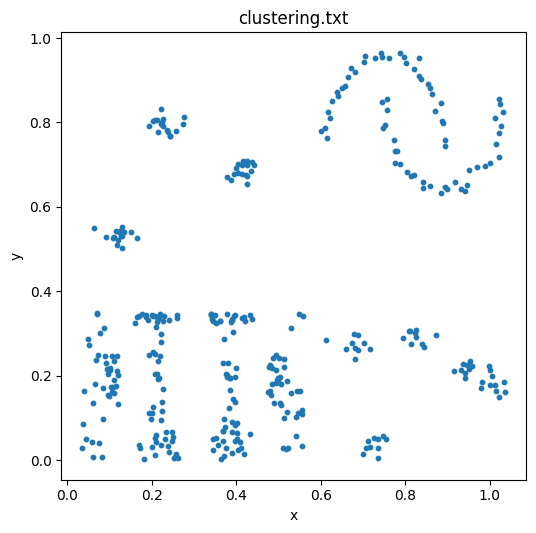
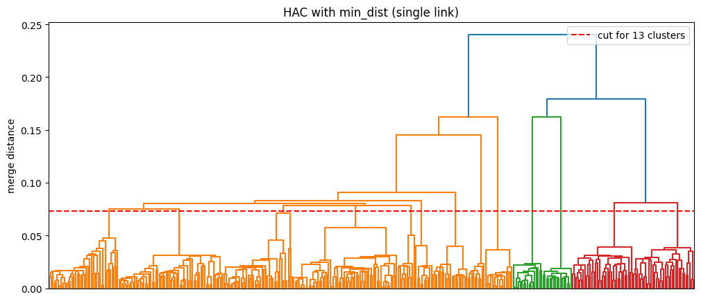
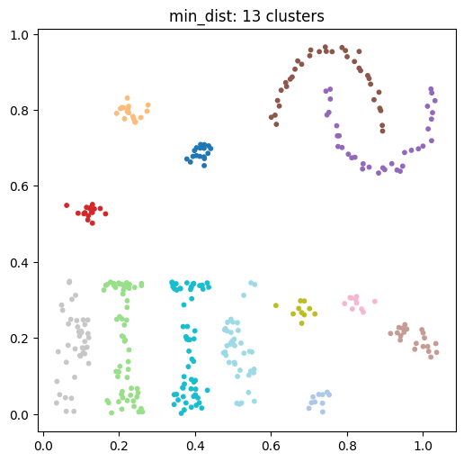
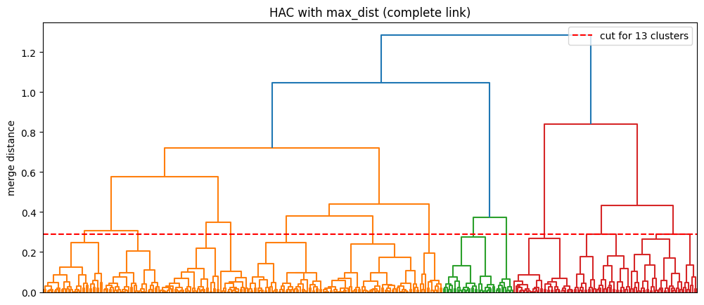
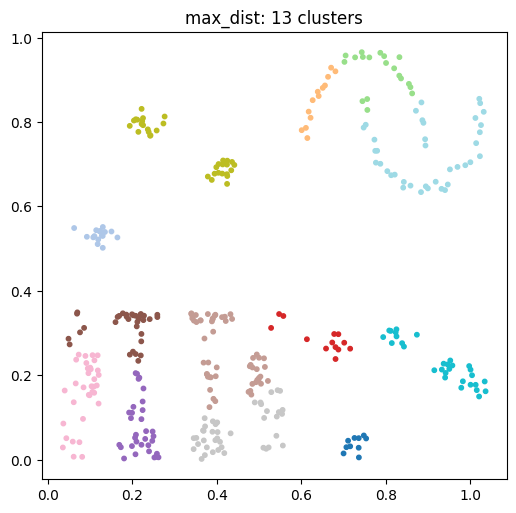

# CS 6220 Data Mining Techniques: Homework 4

This repository contains my solution to Homework 4, which covers frequent itemset mining, association rules, and hierarchical clustering.

## Notebook structure

**Part 1: Frequent Itemsets**
- `support` and `confidence` functions
- Apriori built from three steps: `join` (create candidates), `prune` (remove candidates with an infrequent subset, and record them), and `count` (keep candidates that meet `min_sup`)

**Part 2: Association Rules**
- `apriori_rules`, which grows rule consequents level by level using the same `join` and `prune` steps
- Support, confidence, and lift for every rule

**Part 3: Hierarchical Clustering**
- `hac`, which takes the cluster distance function (`min_dist` or `max_dist`) as a parameter
- Distances are updated incrementally after each merge, without recomputing distances between points
- Dendrograms and cluster plots for both distance functions

## Results

### Frequent itemsets (`min_sup = 0.25`)

| k | Frequent itemsets (support) |
|---|---|
| 1 | Bread 0.40, Butter 0.30, Cereal 0.25, Eggs 0.30, Milk 0.55 |
| 2 | {Bread, Butter} 0.30, {Bread, Eggs} 0.25, {Bread, Milk} 0.25, {Butter, Milk} 0.25 |
| 3 | {Bread, Butter, Milk} 0.25 |

| k | Candidates | Pruned | Pruned candidates |
|---|---|---|---|
| 2 | 10 | 0 | none |
| 3 | 3 | 2 | {Bread, Butter, Eggs}, {Bread, Eggs, Milk} |
| 4 | 0 | 0 | none |

Pruning removed 2 of the 3 candidates at k = 3. In total, Apriori computed 23 supports, instead of the 4,095 needed to check every possible itemset of the 12 items.

### Association rules (`min_conf = 0.6`)

| Rule | Support | Confidence | Lift |
|---|---|---|---|
| {Bread, Milk} → {Butter} | 0.25 | 1.000 | 3.333 |
| {Butter} → {Bread} | 0.30 | 1.000 | 2.500 |
| {Butter, Milk} → {Bread} | 0.25 | 1.000 | 2.500 |
| {Butter} → {Bread, Milk} | 0.25 | 0.833 | 3.333 |
| {Eggs} → {Bread} | 0.25 | 0.833 | 2.083 |
| {Butter} → {Milk} | 0.25 | 0.833 | 1.515 |
| {Bread, Butter} → {Milk} | 0.25 | 0.833 | 1.515 |
| {Bread} → {Butter} | 0.30 | 0.750 | 2.500 |
| {Bread} → {Butter, Milk} | 0.25 | 0.625 | 2.500 |
| {Bread} → {Eggs} | 0.25 | 0.625 | 2.083 |
| {Bread} → {Milk} | 0.25 | 0.625 | 1.136 |

The strongest rule is {Butter} → {Bread}: perfect confidence, the highest support, and a lift of 2.5. The weakest is {Bread} → {Milk}: its lift of 1.136 is barely above independence, and it passes the confidence threshold mainly because Milk is so common.

### Hierarchical clustering

The dataset contains 13 natural clusters.



**min_dist (single link):** all 13 natural clusters are recovered, including the long shapes and the two interleaved crescents.





**max_dist (complete link):** long shapes are split into pieces (the crescents into 3 parts, the four tall shapes into 5 parts), while some separate small groups are merged together.





min_dist matches intuition better. It merges clusters based on their closest points, so chains of nearby points stay together however long they are. max_dist merges based on the farthest points, so it favors compact clusters of similar size and breaks up long shapes.

## Requirements

- Python 3.9 or later
- The packages listed in `requirements.txt`: numpy, pandas, matplotlib, scipy, and jupyter

## Setup and running

1. Clone the repository and move into it:
   ```bash
   git clone https://github.com/AchintyaShah25/DataMiningTechniquesHW4.git
   cd DataMiningTechniquesHW14
   ```

2. Create and activate a virtual environment:
   ```bash
   python3 -m venv venv
   source venv/bin/activate        # macOS / Linux
   venv\Scripts\activate           # Windows
   ```

3. Install the dependencies:
   ```bash
   pip install -r requirements.txt
   ```

4. Start Jupyter and open the notebook:
   ```bash
   jupyter notebook homework_4.ipynb
   ```

5. Run all cells from top to bottom (**Kernel → Restart & Run All**).